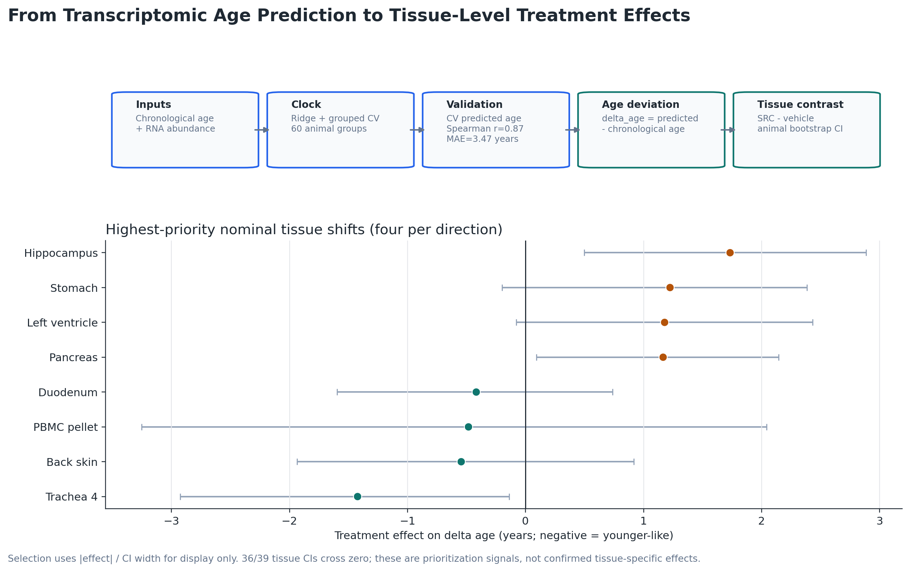
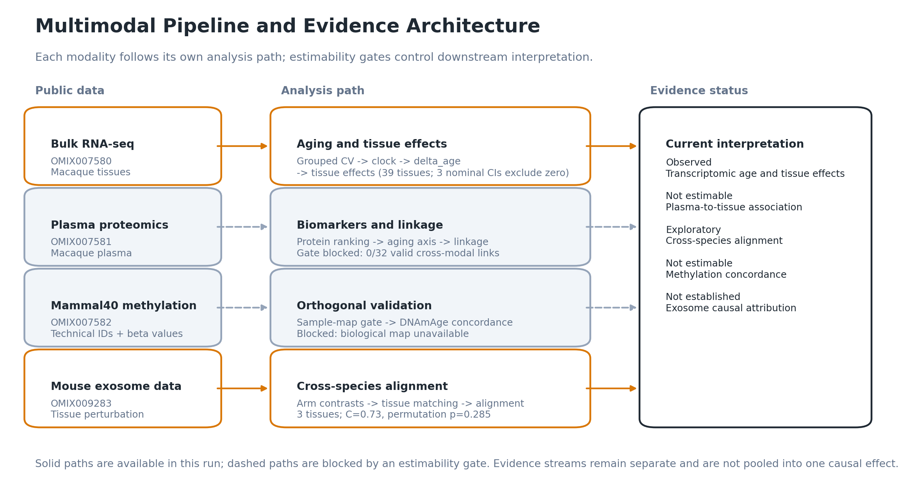
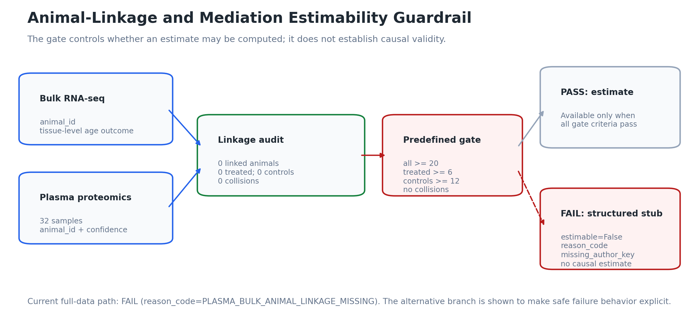

# OMIX Exosome Rejuvenation

**A multi-omics reanalysis of aging signals after cell therapy in macaques,
with a comparison to a mouse exosome experiment.**

[](https://github.com/richard2049/Omix-exosome-rejuvenation/actions/workflows/ci.yml)

## Research Question

After treatment with senescence-resistant cells (SRCs), do age-related changes
in macaques reflect responses within tissues, or could circulating exosomes
(small vesicles released by cells) help explain them? The distinction matters for
which biomarkers to measure and which follow-up experiments to run.

Using public OMIX data, the project models chronological age from tissue RNA
and estimates treatment contrasts at the animal level. **The clock tracked
chronological age. The treatment estimates were too uncertain to establish
transcriptomic rejuvenation.**

### Start Here

- [Scientific results](RESULTS.md) and [full-run evidence tables](docs/evidence/2026-09-26/README.md)
- [Study design](docs/study_design.md) and [inference framework](docs/inference_framework.md)
- [Environment, execution, and tests](docs/reproducibility.md)

## Evidence at a Glance

Results from the [corrected September 2026 full-data run](docs/evidence/2026-09-26/README.md).

| Analysis | Evidence status | Finding |
|---|---|---|
| Transcriptomic clock | **Observed** | On held-out controls, the Ridge model gave Spearman `r = 0.87` and an animal-balanced mean absolute error of `3.47` years. Predictions compressed the age range. |
| Tissue treatment contrasts | **Observed, uncertain** | The global SRC-minus-vehicle estimate was `+0.46` years (95% CI `-0.76` to `1.61`). None of the 39 tissue comparisons passed correction for multiple testing. |
| Plasma proteomics | **Exploratory** | The median SRC score shifted toward the young reference (`-1.69` units versus vehicle). The interval crossed zero, and the young–old reference difference was uncertain. |
| Macaque–mouse comparison | **Exploratory** | Three organ-compatible tissue pairs showed positive directional alignment (`C = 0.73`), with a wide interval and permutation `p = 0.285`. |
| Macaque methylation | **Not estimable** | Mammal40 assay identifiers lack a verified map to biological samples. |
| Plasma–tissue association and mediation | **Not estimable** | Plasma and tissue samples lack confirmed matches to the same animals. |
| Exosome causality | **Not established** | The public study design lacks direct evidence linking exosome exposure or cargo transfer to recipient outcomes in macaques. |

`Observed` means the analysis produced an estimate. `Exploratory` results
can guide follow-up studies. The [inference framework](docs/inference_framework.md)
requires corroborating evidence for a `Supported` claim, and
no current mechanism-facing claim meets that threshold.



*Figure 1. The controls-only clock keeps animals separate across training and
validation folds. Treatment contrasts use `delta_age`, the difference between
predicted and chronological age. Three of the 39 pointwise confidence intervals
exclude zero.*

## Data and Workflow

The main datasets cover macaque tissue RNA, plasma proteomics, and DNA
methylation, alongside a mouse exosome experiment. The [dataset guide](docs/datasets.md)
lists the OMIX accessions and supporting datasets. The [group-label crosswalk](docs/group_label_crosswalk.md)
documents how the deposited group names map to the study arms.



*Figure 2. The workflow checks which comparisons each dataset supports. The
plasma measurements support analysis within that assay. Comparisons with
tissue measurements require confirmed animal identities.*

## Evidence and Claim Boundaries

Analyses that link plasma and tissue require a verified animal-level map and
sufficient matched samples. Mediation would also require causal assumptions
beyond sample identity. The macaque transcript matrix needs a verified feature
map before it can support gene- or pathway-level analysis.
[Data linkage](docs/data_linkage.md) · [Scientific limitations](docs/scientific_limitations.md)



*Figure 3. The linkage audit found 24 candidate aliases and zero confirmed
links between plasma and tissue samples. Mediation requires confirmed links.*

## Reproduce the Analysis

The public demo checks that the software runs on synthetic example data and
produces the expected output tables.

```bash
conda env create -f environment.yml
conda activate srsc
python -m src.run_pipeline --profile demo --safe
python -m src.demo_validation
```

Recomputing the reported analyses requires the full profile and matching input
files. Use a separate checkout to keep demo and full outputs apart.

```bash
python -m src.run_pipeline --profile full --data-root /path/to/omix-data
python -m src.report_figures
```

See the [reproducibility guide](docs/reproducibility.md) for input checks,
scientific guardrail tests, and how to compare a new full run with September.

## Repository and Documentation

| Path | Purpose |
|---|---|
| `src/` | Analysis, audit, attribution, and reporting modules |
| `tests/` | Automated scientific guardrails and smoke tests |
| `data/PROCESSED/` | Synthetic inputs for the demo. [Generation and source data](docs/datasets.md#demo-inputs-and-redistribution) |
| `results/`, `figures/` | Generated machine-readable outputs and figures |
| `docs/` | Study context, evidence rules, dataset audits, reproducibility, and output reference |

[Documentation index](docs/README.md) · [Output and figure reference](docs/outputs.md)
· [GitHub Issues](https://github.com/richard2049/Omix-exosome-rejuvenation/issues)

## Citation and License

Cite the software using [CITATION.cff](CITATION.cff) and the
[commit or release you used](docs/release.md). The source code is distributed
under the [MIT License](LICENSE).
